##### Department of Electrical & Electronic Engineering
##### Imperial College London

#### **ELEC50001 Circuits & Systems**

### **Lab 6 – ADC and Echo Synthesizer**
##### *Peter Cheung, v4.0 - 23 Nov 2026*

#### **Learning Outcomes**

In Lab 6 you will learn to combine the ADC with the DAC and use the DE10 to perform some simple audio signal processing. 

The goal of the final week’s laboratory session is to implement a speech echo effect synthesizer.  You need to obtain from the Lab a 3.5mm audio cable for this lab.

This Lab requires you to use the Sallen-Key LP filter and an inverting amplifier (all on the dual op-amp MCP6002) and the audio amplifier driving the speaker.  You will also be using the DAC chip from Lab 5, and a new chip MCP3201 ADC.  You can find its datasheet on the course webpage.  As in previous labs, all solutions (.sof files) are provided so that you know what is expected.

---
### **Task 1: Analogue to Digital Conversion using the MCP3201 ADC device**
---

In this task, you will use the 10k ohm variable resistor to provide a DC voltage between 0 to 3.3V to the ADC, which also uses SPI to interface to the FPGA.  The DC voltage is converter to a 10-bit digital number, which is displayed on the 7-segment displays.

#### **Step 1:  Connect the MCP3201 to the DE10**

Just like Lab 5, we need to wire up the MC3201 ADC to the DE-10 Lite FPAG board.  Shown below is a wiring layout added to DAC chip you wired up in Lab 5.  The circled parts are additional circuits on the prototype shield.  

 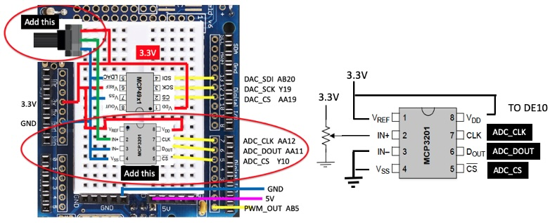 

Note the following:
1.	The MCP3201 chip orientation is the opposite of that of the DAC chip.  This orientation is chosen to make wiring up the signals to the header sockets as easy as possible.  Pin 5 to 7 of the MCP3201 is aligned to the FPGA signal sockets.
2.	The 10k ohm variable resistor is used to supply a DC voltage to the IN+ input pin of the ADC.

#### **Step 2: The ADC and spi2adc.sv**

Go to the course webpage and download the datasheet for the MCP3201 and the Lab6.zip file which contains SystemVerilog files you need for this lab.

In particular, you will find the file **_spi2adc.sv_**, which is a SystemVerilog module that implements the SPI interface circuit to communicate with the ADC. 

Don’t worry about details of how **_spi2adc.sv_** works – it is very similar to the working of **_spi2dac.sv_**, which will be explained in a later lecture.  Note that although MCP3201 is a 12-bit converter, the least significant 2 bits are not reliable.  Therefore **_spi2adc.sv_** only returns the top 10 bits of the converter results.  

 
 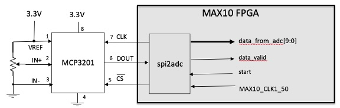 

 This is the block diagram showing the interface signals to **_spi2adc.sv_** module.  The three signals on the left are the SPI signals communicating with the ADC chip.  **CLK** provides the serial clock signal at 1MHz.  **CS** signal is asserted low during a conversion.  **DOUT** provides the 10-bit converted data serially to the FPGA.

To start a conversion, the signal **“start”** is asserted for one clock cycle (20ns).  MCP3201 then provides the converted data, which is stored in a serial-in/parallel-out shift-register inside the **spi2adc** module. Once all bits are received, converted data is driven on **data_from_adc** and **data_valid** is asserted.

#### **Step 3: Test the ADC chip**

To verify that the ADC works properly, create the project **lab6task1** that implements the circuit shown in the following diagram.  Download from the course webpage the top-level module **_lab6task1.sv_**.  Make sure that you understand the SystemVerilog code and why it implements the circuit.  Note the following:

* The sampling frequency is governed by the frequency of tick, which is at 10kHz.
* The maximum IN+ is nominally 3.3V. However, it is likely to be higher. Use the multimeter to measure the full-scale voltage range.

 
 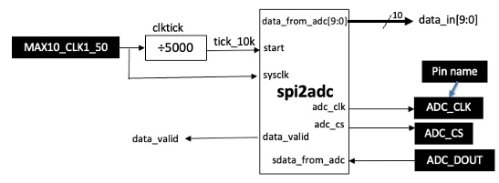 

 
 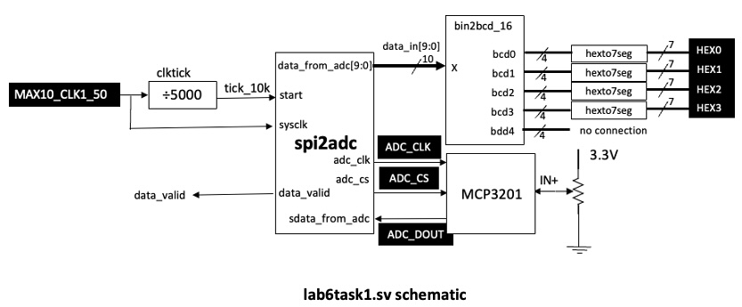 

#### Test yourself (optional extension)

Modify **_lab6task1.sv_** such that the display is the actual voltage in mV.  For example, if the full-scale voltage is 3.312V, the display should show four digits with a value close to 3.312.  Here are some useful hints:

1.	All 7-segment displays has an eighth “segment” which is the decimal point (DP).  For example, HEX3 is actually HEX3[7:0] where HEX3[6:0[ are the 7 segments, and HEX3[7] is the decimal point DP.  If HEX3[7] = 1’b0, DP will be lid (i.e. low active).  
2.	You may assume that a converted digital value of 1000 corresponds to a voltage of 3.3V.  
3.	The multiply operator “*” can be used in SystemVerilog for unsigned multiplication.

---
### **Task 2:  DAC working with ADC (test yourself)**
---

Create a new project **lab6task2** and design the following circuit as **_lab6task2.sv_**. (I deliberately leave you to create lab6task2.sv yourself to test that you can do it on your own.  Of course, lab6task1.sv provides a good starting point for you.)

This design takes a 10-bit digital number specified with the 10 sliding switches and uses the DAC to produce the analogue voltage **VOUT**.

**VOUT** is looped back to the input of the ADC, which is converted back to a digital value and displayed in mV on the 7-segment displays.  The sampling frequency is 10k sample/sec.

Test your design by changing the values of **SW[9:0]** and check the displayed voltage.

 
 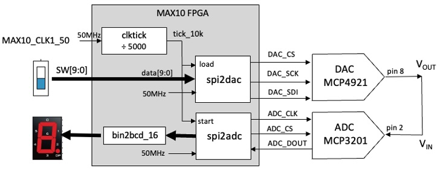 

---
### **Task 3: ADC to DAC signal processor platform – allpass processing**
---

The purpose of task 3 is to prepare you for later tasks where the analogue audio signal from your phone or your computer is sampled with the ADC, stored and processed using the processor module on the FPGA, then converted back to analogue signal with the DAC to drive the speaker via the audio amplifier.  

**Step 1:  Preparing the analogue components**

Build the following x3 inverting amplifier with the spare op-amp from **Lab 5 task 1** where you built the Sallen-Key LP filter. 

 
 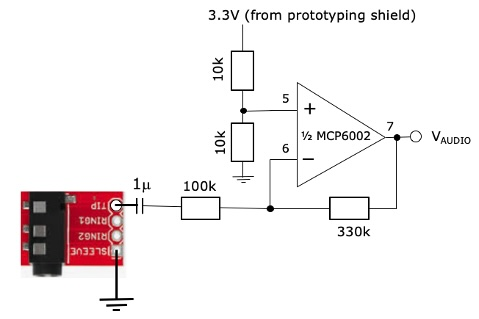 

The signal from a phone or a computer audio socket is around 0.9V peak-to-peak.  Therefore, a gain of x3 would bring this up to the input voltage range of the ADC of around 3V peak-to-peak.  The two 10k resistors provide a DC offset of 1.65V to maximize the voltage swing at VAUDIU.   The 3.3V source is taken from the prototype shield 3.3V supply pin.

**Step 2: Test the analogue system**

Combine the inverting x3 amplifier with the lowpass filter (**Lab 5 Task 1**) and the audio amplifier (**Lab 5 Task 3**) as shown below.

The x3 inverting amplifier produce an audio signal of the right amplitude.  The lowpass filter serves as anti-aliasing filter to prevent frequency components higher than half the sampling frequency from being “folded back” to the base band.  The audio amplifier drives for the 8-ohm speaker so that you can hear the audio.

Connect the 3.5mm socket to your computer or phone audio socket using the 3.5mm cable.  Play a piece of music or an audio book to supply an audio signal to the analogue system. You may also download a 5-munites long audio book file from course webpage (**hg2g_5min.mp3**).  If everything works properly, you should hear the audio signal on the speaker.

 
 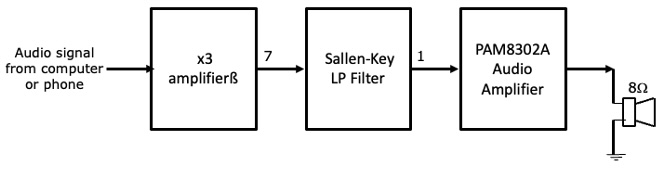 

**Step 3: Combining FPGA and analogue system**

You will be needing the following modules, most of them are either already in Lab 6 folder which you have downloaded at the start of this Lab Session.

 
 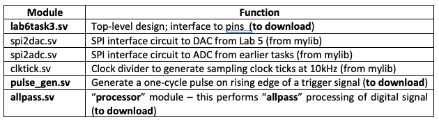 

 
* Study **_lab6task3.sv_**.  This specifies a system as shown in the following diagram.  Make sure you understand how this works.
* Now examine the file **_allpass.sv_**.  The name of this module is **“processor”** and is different from the name of the SystemVerilog file.  There is no need to use the same name except that normally it is more convenient to do so.  However, in this case, we have deliberately used the filename **“allpass.sv”** to describe its function, while using **“processor”** as the module.  You can choose **“allpass.sv”**** as the source of the module **“processor”**** now.  Later, you can have a different SystemVerilog file to define a different **“processor”**.  Which version of **“processor”** you use in your design is specified in **Project > Add/Remove File in Project**. 
 
  
 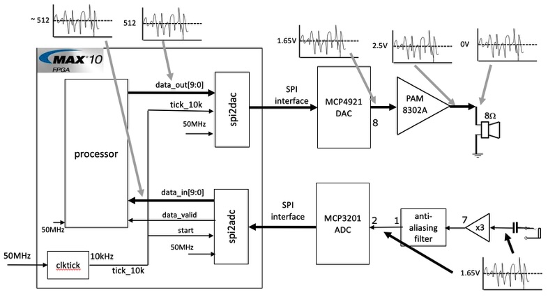 

  >Make sure that you understand fully what the Verilog file **“allpass.v”** does.  It performs the following tasks:
  1.	Remove the DC offset from the ADC converter data by subtracting 512 from **data_out[9:0]** to obtain a 2’s complement value **x[9:0]**.
  2.	Register input data X to drive output Y, i.e. does nothing except one clock cycle delay, and hence we call this operation **“allpass”**.
  3.	Converts the Y value from 2’s complement to offset binary for the DAC. The offset now is also 512 as shown below.
  

 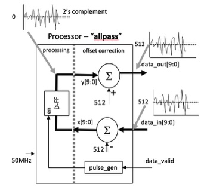 

Build your design for testing on the DE10 Board.  To do this, you should:
1.	Open each .sv file, and use **Processing > Analyze Current File** on each of the SystemVerilog file to ensure that there is not syntax error.
2.	Use **Project > Add/Remove File in Project** to include all the .sv files you need.  Here we select **allpass.sv** to supply the **“processor”** module.  In the future, you could substitute allpass.sv with another file for a different processor.
3.	While **lab6task3.sv** is the current file in the editor window, use **Project > Set as Top-level Entity** to define top is the top-level module.
4.	Check that Device and pin are all assigned correctly.
5.	Compile the whole design and download the bit-stream file “**lab6task3.sof**” to DE10.
6.	Test that it is working properly. You can use three audio files provided on the course webpage: **clapping.mp3** (sequence of single claps), **hello.mp3** (I saying hello), h**hg2g_5min.mp3** (a 5-minutes long audio book).

When you get to this part, the experiment framework is shown to be working. It takes audio samples at 10kHz from the ADC, passes it through the processor module and output the processed sample to the DAC and produces the output audio on the speaker. 

### Test yourself

Modify the **“processor”** module (i.e. you may call the SystemVerilog file **times2.sv** but the module name is still **“processor”**) which amplifies the input by a factor of two.  Test that this is working (i.e. the signal to the speaker should be louder or distorted).  

---
### **Task 4:  Simple Echo Synthesizer with fixed delay**
---

In this part of the experiment, you will design, implement, and test a circuit that simulates the effect of a simple echo.  The diagram below shows two components of a sound source reaching its listener: the direct path signal **_x(t)_** and the echo signal **$\beta$ x(t-T)** which is a weaker version of **_x(t)_** attenuated by a factor $\beta$, bounced off the floor.  The echo signal is also delayed by **_T_** relative to the direct-path signal **_x(t)_**.

 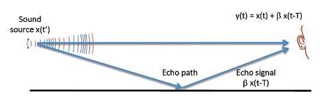 

Such simple echo can be implemented as signal flow graph as shown below.  This involves three components: a delay block that delays **_x(t)_** by K sample periods; a gain block which multiplies the delayed signal by the factor $\beta$; and the adder.  

 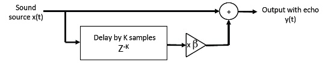 

**Step 1: Generate a FIFO as an IP Block on Quartus**

The delay block can be implemented with a **first-in-first-out** (FIFO) buffer.  A FIFO is found in all forms of digital systems.  The rule is simple: received data are stored in sequence in such a way that they can be retrieved in the order that they arrived. When a new data item arrives and the FIFO is not full, it is written to the FIFO.  As a data item is retrieved, it is removed from the FIFO. This allows the send and retrieves rates to be different in the short term. If the send rate is higher than the retrieve rate, eventually the buffer will become full. If the buffer is full, it should not receive any more data (otherwise existing stored data would be overwritten). A “**full**” status signal is asserted to tell the sender not to send any more data. Similarly, if the buffer is empty, it cannot provide any data for retrieval.  An “**empty**” status signal is used to indicate that the FIFO has no more data to provide.

Create a new project using modules from Task3.  Use the IP Catalog tool, generate a FIFO component of size 8192 x 10-bit as shown here.  The command is:  
>**Tool > IP catalog**.    On the right of the Quartus window, you will see the IP Catalog pane.  Click:  **Library > Basic Functions > On Chip Memory > FIFO**.

This utility is provided by Intel/Altera to generate Intellectual Property (IP) blocks that use a combination of the programmable logic fabrics (LEs), and other “**hard**” blocks such as memory blocks and DSP blocks. 
When asked for the name of the IP variant, enter “**fifo**”. 
Several pages will appear on a pop-up window.  

When completing the pop-up forms, use default values except the following:

**Page 1**: FIFO **width** = 10 bits, FIFO depth = 8192 words.

**Page 2**: Untick **empty** and **usedw[]** control signal (not needed).

**Page 8**: Check **_fifo_inst.v_** (the instantiation template file).

Once finished, a file **_fifo.qip_** will appear in your project folder along with a number of other files with similar names.  To use the FIFO in your design, you must include **_fifo.qip_** in your project.

>**IMPORTANT**:  Note that Altera provides many pre-designed IP (Intellectual Property) blocks for you to use. Fifo is one such design.  The IP catalog utility produces Verilog instead of SystemVerilog specification for IP blocks.  That is not a problem.  Your design can include modules designed in either Verilog, SystemVerilog or even VHDL.  Mixing different HDL is allowed.

data[9:0] 	FIFO input data
q[9:0]		FIFO output data
wrreq		write request (high to write a word on rising clock edge)
rdreq		read request
full		high if FIFO is full
clock		FIFO clock signal

 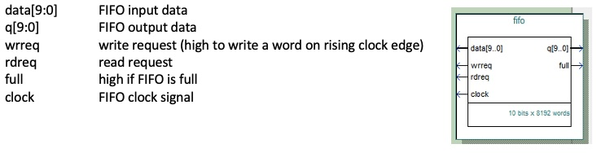 

**Step 2:  Test yourself**

Implement the simple echo simulator according to the block diagram shown below.  The **_pulse_gen.sv_** module produces a single pulse for a rising edge on **data_valid**.  The FSM (shown in blue) is a challenge for you.  Initially the FIFO is empty.  If you read a data sample immediately after one is written, the FIFO will never be filled, and it will not implement any delay function. The FSM is a simple 2-states state machine which makes sure that the FIFO is only read AFTER it is filled with 8192 samples. Thereafter, the read and write functions work synchronously and the FIFO will always contain the previous 8192 of audio samples.

To test that your design works, download three different sound files: **clapping.mp3**, **hello.mp3** and **hg2g_5min.mp3**, and play them on a computer or a phone in a loop.  Listen to the effect of the echo synthesizer on the speaker.  Measure the echo delay with the scope.

 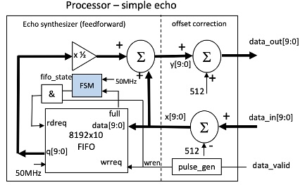 

**Step 3: Test yourself with multiple echoes**

The design above produces a single echo.  The signal flow graph only has feedforward paths.  Multiple echoes can be produced with a minor modification of the signal flow graph to the one shown below.  

 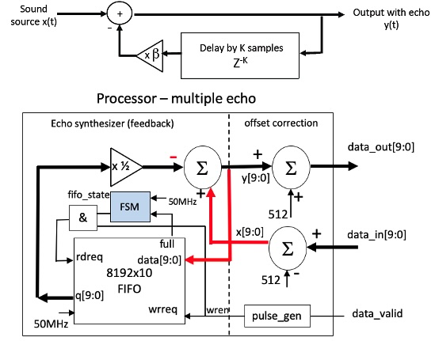 
 

The delay block now stores the output sample y(t) instead of the input sample x(t).  The attenuated and delayed y(t) is SUBTRACTED from x(t) to produce the next output.  (Why must this be a subtract and not an add?)

Provide a design to implement this architecture and test it.

> CONGRATULATIONS! YOU HAVE COMPLETED ALL THE LABS FOR THIS MODULE. NEXT ARE THE CHALLENGES.